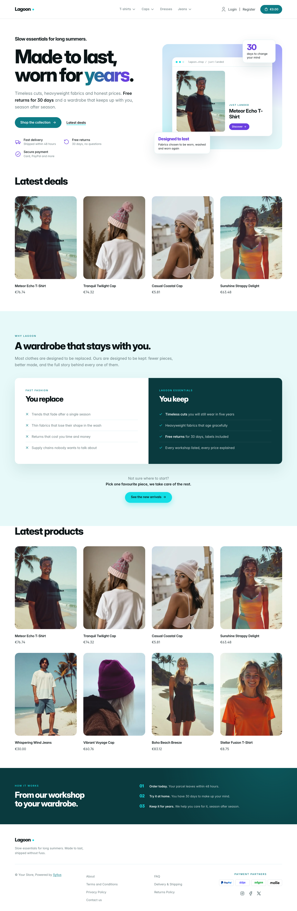
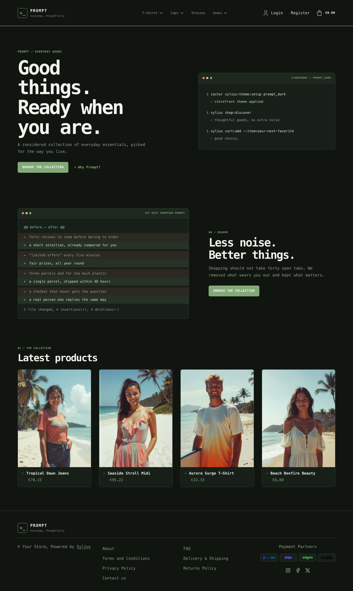
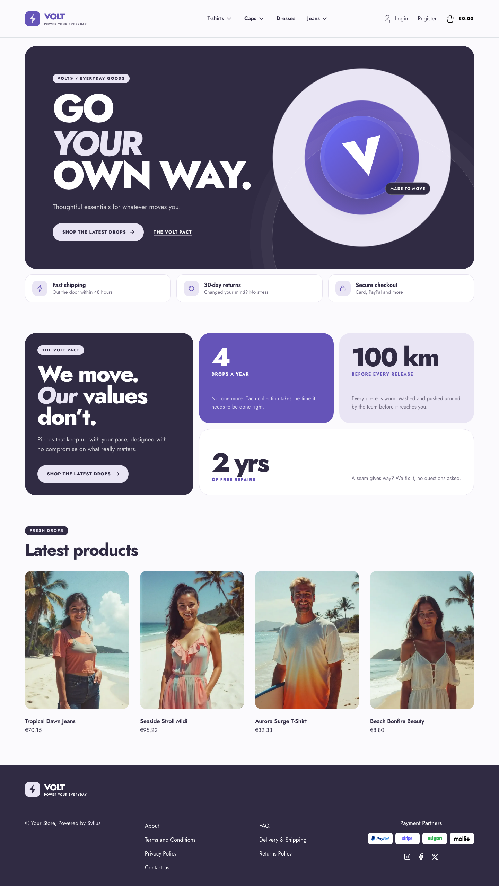

# Sylius Starter

A set of [Castor](https://castor.jolicode.com/) packages that turns a PHP description of
your stack into a Sylius app, and gives you the tasks to drive it.

> Formerly the `castor-php/sylius` Castor plugin, see the [upgrade guide](docs/getting-started/upgrading.md).

Instead of a list of manual steps, each workflow is a single, deterministic command: installing or removing a plugin
(entities, migrations, assets, cache), switching the storefront theme, enabling B2B features, cleaning up the Admin
menu or importing a catalog. That makes it a reliable interface for you and for AI agents alike.
[Why Sylius Starter?](docs/index.md#why-sylius-starter)

## Quick start

Requires [Docker](https://docs.docker.com/get-docker/) with Compose and
[Castor](https://castor.jolicode.com/getting-started/installation/). Create a new project with the
[skeleton](https://github.com/sylius-starter/skeleton):

```bash
git clone --depth=1 https://github.com/sylius-starter/skeleton.git my-shop
cd my-shop
rm -rf .git && git init

castor sylius:init
```

`castor sylius:init` asks a few questions (name, PHP version, domain, database, theme, payment gateways…), then builds
and starts everything.

See [Installation](docs/getting-started/installation.md) for the unattended install, or to add Sylius Starter to an
existing Castor project.

## What you get

| Command                                                        | Package                  |
|----------------------------------------------------------------|--------------------------|
| [`castor sylius:add` / `sylius:remove`](docs/commands/plugins.md) | `sylius-starter/plugins` |
| [`castor sylius:theme:setup`](docs/commands/themes.md)          | `sylius-starter/themes`  |
| [`castor sylius:menu:remove`](docs/commands/admin-menu.md)      | `sylius-starter/menu`    |
| [`castor sylius:b2b:enable`](docs/commands/b2b.md)              | `sylius-starter/b2b`     |
| [`castor sylius:import:*`](docs/import/index.md)                | `sylius-starter/import`  |
| [`castor sylius:upsun:*`](docs/commands/upsun.md)              | `sylius-starter/upsun`   |

Every package relies on `sylius-starter/core`; `sylius-starter/sylius-starter` installs them all. See
[Packages](docs/getting-started/packages.md).

| [Canvas](docs/themes/canvas.md) | [Lagoon](docs/themes/lagoon.md) | [Prompt Dark](docs/themes/prompt_dark.md) | [Volt](docs/themes/volt.md) |
|---|---|---|---|
|  |  |  |  |

[All the themes](docs/commands/themes.md)

## Documentation

Read it online at [sylius-starter.github.io/docs](https://sylius-starter.github.io/docs/), or here on GitHub:

- **Getting started**: [Introduction](docs/index.md), [Installation](docs/getting-started/installation.md),
  [Packages](docs/getting-started/packages.md), [Upgrading from `castor-php/sylius`](docs/getting-started/upgrading.md)
- **Commands**: [Plugins](docs/commands/plugins.md), [Themes](docs/commands/themes.md),
  [Admin menu](docs/commands/admin-menu.md), [B2B features](docs/commands/b2b.md), [Upsun](docs/commands/upsun.md)
- **E-commerce import**: [Overview](docs/import/index.md), [AI-generated catalog](docs/import/ai-catalog.md),
  [Existing website](docs/import/existing-website.md), [Fixtures](docs/import/fixtures.md),
  [Extending the import](docs/import/extending.md)
- **Extending**: [Plugins and themes](docs/extending/index.md), [App and helpers](docs/extending/toolbox.md),
  [Custom tasks](docs/extending/tasks.md)
- **Storefront slots**: [Homepage hero](docs/storefront/hero.md), [Shop logo](docs/storefront/brand.md)
- **Contributing**: [Monorepo](docs/contributing/monorepo.md), [Releasing](docs/contributing/releasing.md),
  [Theme screenshots](docs/contributing/screenshots.md)

## Contributing

This repository is the development monorepo of every `sylius-starter/*` package: each package is split into its own
**read-only** repository by the CI, so issues and pull requests always go here. See
[Monorepo](docs/contributing/monorepo.md).

## License

Sylius Starter is released under the MIT license.
